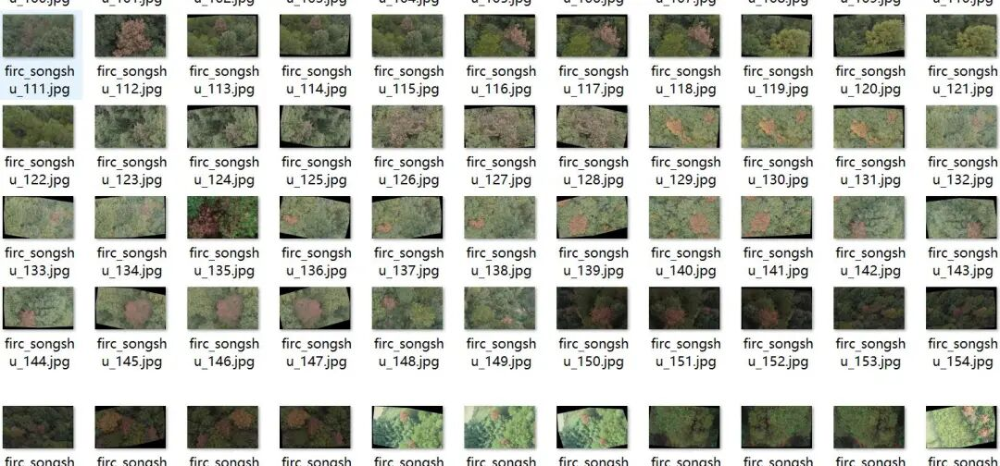
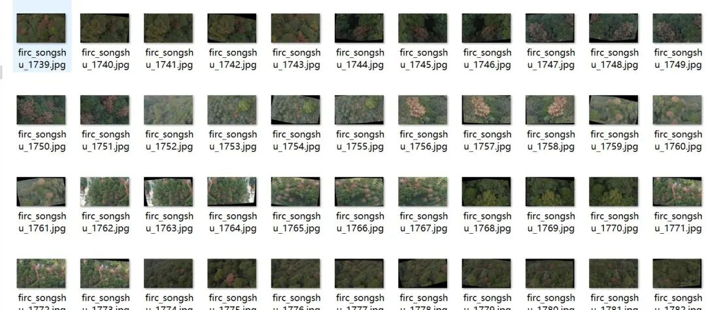
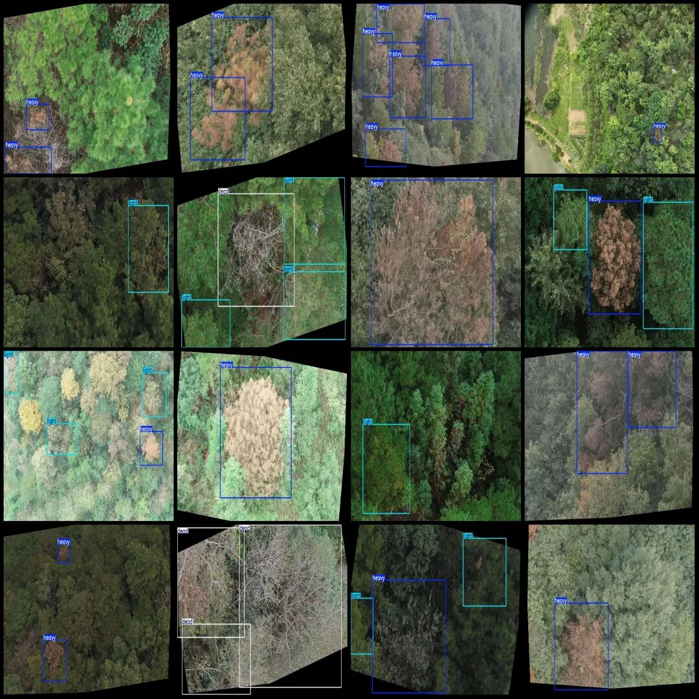

# Dataset of drone-viewed Pine Disease Detection in VOC+YOLO format with 2177 images and 3 categories

In the dataset, there are over 800 original images and the rest are enhanced images.

Dataset format: Pascal VOC format + YOLO format (txt file without split path, only containing jpg images and corresponding VOC format xml files and yolo format txt files)

Number of images (number of jpg files): 2177

Number of annotations (number of xml files): 2177

Number of annotations (number of txt files): 2177

Label category count: 3

Label category names (Note that the order of categories in the YOLO format does not correspond to this, but is based on the labels folder's classes.txt): ["dead", "heavy", "light"]

Number of boxes labeled in each category:

Dead Frame Count = 1086

Number of heavy boxes = 4144

Light Frame Count = 1109

Total frame count: 6339

Using labelImg:

Annotation rules: Draw a rectangle around the category.

Important Notice: No

Special : This dataset does not guarantee the accuracy or precision of the trained models or weight files. The dataset is provided with accurate and reasonable annotations only.

Image Preview:

Annotation example:

## Payment

Here is a pay link on Stripe ( https://buy.stripe.com/3cs8yP7sY87d0vu9AB ). Please contact me lonlonago@foxmail.com after funding $89, and I will send you a complete data files , thank you!

